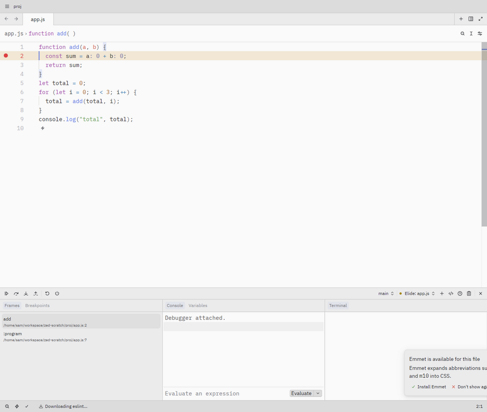

# Elide for Zed

[Elide](https://elide.dev) support for the [Zed](https://zed.dev) editor:

- **Language server**: `elide lsp` for Java (diagnostics, completion, hover, navigation, rename, formatting, code
  actions, inlay hints, semantic tokens).
- **Kotlin language server**: opt-in Komodo, with a project manifest generated from Elide's workspace export and
  resolved compile classpaths.
- **JVM debugger**: Komodo launches compiled Java/Kotlin classes or attaches to a JDWP listener over stdio DAP.
- **Debugger**: an `Elide` debug adapter for JavaScript, TypeScript and Python. It launches
  `elide run --debugger=dap` (or `elide test`) and connects to it, or attaches to one you started yourself.
- **Debug from tasks**: any Zed task that runs `elide run …` or `elide test …` shows up in the debugger's
  **Debug** tab.
- **Build authoring**: TypeScript, TSX, JavaScript and Pkl snippets from the VS Code extension.



## Requirements

- Elide 1.6.0 or newer on `PATH`, or set its path in settings (below). Python debugging needs an Elide build with
  Python.
- The [Java](https://github.com/zed-extensions/java) extension, which defines the Java language in Zed.
- For Kotlin, the Kotlin extension that defines the language, plus a compatible Komodo distribution and JDK.
  Managed Komodo requires an Elide version providing `elide komodo resolve --json`; Elide 1.6.3 does not provide
  that command, so configure an explicit Komodo path with that version.
- For `elide.pkl` highlighting, the [Pkl](https://github.com/Moshyfawn/pkl-zed) extension. This extension does not
  ship a Pkl grammar of its own.

## Install

Until the extension is in Zed's registry, install it as a dev extension (needs Rust via `rustup`):

```bash
git clone https://github.com/elide-dev/zed elide-zed
```

In Zed, open the Extensions page, click **Install Dev Extension** and select the `elide-zed` directory.

After changing Rust code, use Zed's dev-extension rebuild action, or build and update the file Zed loads:

```bash
cargo +1.90 build --release --target wasm32-wasip2
cp target/wasm32-wasip2/release/zed_elide.wasm extension.wasm
```

Restart Zed after manually replacing the WASM. For manifest changes, reinstall/rebuild the dev extension to
refresh Zed's cached extension index; restarting alone can retain old capabilities. `cargo build` alone does
not update the root `extension.wasm`. Native tests do not exercise capability enforcement or WASI filesystem.

## Java language server

Name `elide` in the Java `language_servers` list. To use it instead of jdtls:

```json
{
  "languages": {
    "Java": {
      "language_servers": ["elide", "!jdtls", "..."]
    }
  }
}
```

Keep both with `["elide", "jdtls"]`, or turn Elide off with `["!elide", "..."]`. Zed builds that support
`opt_in_languages` start `elide` for Java only when you name it; older builds start it next to jdtls.

`elide lsp` reads the workspace root Zed sends; an `elide.pkl` there marks an Elide project.

To use a specific binary or extra flags:

```json
{
  "lsp": {
    "elide": {
      "binary": {
        "path": "/opt/elide/bin/elide",
        "arguments": ["lsp"],
        "env": { "NO_COLOR": "1" }
      }
    }
  }
}
```

`arguments` replaces the default `["lsp"]`. `initialization_options` and `settings` are passed to the server as-is.

## Kotlin language server

Enable `elide-komodo` explicitly; do not run it alongside another Kotlin server unless that is intentional:

```json
{
  "languages": {
    "Kotlin": { "language_servers": ["elide-komodo"] }
  },
  "lsp": {
    "elide-komodo": {
      "settings": {
        "komodoPath": "/opt/komodo/komodo",
        "javaHome": "/opt/jdk",
        "maxHeap": "1g"
      }
    }
  }
}
```

An explicit executable is authoritative: a missing/broken override never falls back to another installation.
Without `settings.komodoPath`, the extension runs `elide komodo resolve --json` and checks its schema and LSP/DAP protocol
identity. It never installs Komodo automatically. With a supporting Elide release, installation is an explicit
terminal action: `elide komodo install --yes --json`.

Do not set `lsp.elide-komodo.binary.path`: Zed treats it as a complete host-side command override and
bypasses the extension launcher, including project export and the generated `--project` argument.

Run `elide install` in the project first. On startup, the extension runs
`elide project export --format=intellij`, then batches `elide classpath <sourceSet>:compile <sourceSet>:provided --json` queries per
workspace member. It writes a worktree-specific `project.properties` to extension storage, not into your project.
The model preserves source roots, module dependencies, test friend modules and production classpaths for tests.
Restart the language server after changing manifests, source sets, dependencies or compiler configuration.
There is no background sync, dependency installation or implicit Android resource build.

Provided dependencies include Android's framework jar and any already-generated resource classes. The manifest
permits only the required export, classpath, and Komodo-resolution command shapes; executable paths remain
configurable. Restricting these operations in Zed's `granted_extension_capabilities` prevents automatic model generation.

Launcher settings under `lsp.elide-komodo.settings`:

| Field | Meaning |
| --- | --- |
| `komodoPath` | Absolute Komodo executable; selects a local distribution without bypassing model generation. |
| `project` | Absolute path to an existing Komodo `project.properties`; bypasses model generation and classpath queries. |
| `elidePath` | Absolute Elide executable for resolution/export; otherwise uses `lsp.elide.binary.path`, then `PATH`. |
| `javaHome` | JDK for Komodo; overrides the managed distribution's JDK. |
| `maxHeap` | Native heap cap, for example `768m` or `1g`. |
| `plugins` | Explicit compiler plugins, for example `["compose=/opt/komodo/plugins/kotlin-compose-compiler-plugin.jar"]`. |

Plugin jars must match Komodo's compiler, not necessarily the project's compiler. Plugin/toolchain needs are not
inferred from the project. Without explicit plugin flags, Komodo applies its own distribution defaults.
`binary.env` overrides the inherited shell environment and `javaHome`; `binary.arguments` replaces the default
LSP arguments entirely. These launcher settings are not forwarded as LSP workspace configuration;
`initialization_options` is forwarded unchanged.

Automatic export supports literal source directories/files and recursive whole-source selectors such as
`src/main/**/*.kt`. Selective globs and UNC roots require a hand-authored compatible manifest via `project`;
unsupported input fails explicitly rather than indexing a broader directory. Commas cannot be represented in
Komodo path lists: move affected sources/dependencies to paths without commas.
For analysis, Java-only modules and edges to them are omitted with reasons in Zed's log; their compiled classes
must be on the resolved classpath. Literal directories cannot be checked for Kotlin files through Zed's Worktree API.
Android projects may need their resource-generation and library-extraction targets built before analysis.

## Java and Kotlin debugger

The `Komodo` adapter is separate from the guest-language `Elide` adapter. It uses the same launcher, environment
and project settings as `elide-komodo`, but always starts `komodo --dap --project …` over **stdio**.
Generated debugger manifests also retain Java-only source roots and are stored separately from analysis manifests.
LSP-only `binary.arguments` are not reused. `dap.Komodo.binary` can override the debugger executable.

Add scenarios to `.zed/debug.json`:

```json
[
  {
    "label": "Attach to JVM",
    "adapter": "Komodo",
    "request": "attach",
    "hostName": "127.0.0.1",
    "port": 5005,
    "timeout": 30000
  },
  {
    "label": "Launch compiled JVM application",
    "adapter": "Komodo",
    "request": "launch",
    "mainClass": "sample.MainKt",
    "classPaths": ["$ZED_WORKTREE_ROOT/build/classes", "/absolute/path/to/kotlin-stdlib.jar"],
    "args": [],
    "cwd": "$ZED_WORKTREE_ROOT"
  }
]
```

For launch, supply the actual compiled output and runtime dependencies (not just source directories); `vmArgs`,
`env` and `javaHome` configure the debuggee. Zed's `build` field can run a compilation task before launch.
For attach, start your JVM with JDWP enabled, or run `elide run --debugger=5005` for a JVM entrypoint.
Use the port printed by Elide. `elide test --debugger=5005` and JVM-starting
`elide build <target> --debugger=5005` can be attached to in the same way.
`sourceRoots` supplies additional source directories if needed.

Do **not** set `tcp_connection` on Komodo: `port` is the debuggee's JDWP port, not the adapter transport.
PID attach and Zed's generic program-only launch dialog cannot describe these JVM scenarios; use `debug.json`.
Open projects at their real filesystem paths when debugging; symlink spellings can prevent breakpoint binding.

The extension cannot monitor a separate Elide process and automatically attach to the port it announces, as
the VS Code extension does. Running that command in a terminal and choosing the attach scenario keeps process
ownership explicit. Stop the terminal command when finished; do not put a suspended, long-running JVM in a
synchronous `build` task.


## JavaScript, TypeScript and Python debugger

Open the debugger with `debugger: start` (F4). Pick a scenario from `.zed/debug.json`, a task in the **Debug** tab,
or **Launch** a program with the `Elide` adapter.

### `.zed/debug.json`

```json
[
  {
    "label": "Debug app.ts",
    "adapter": "Elide",
    "request": "launch",
    "program": "app.ts",
    "args": ["--port", "8080"],
    "env": { "DEBUG": "1" }
  },
  {
    "label": "Debug the current file",
    "adapter": "Elide",
    "request": "launch",
    "program": "$ZED_FILE"
  },
  {
    "label": "Debug tests",
    "adapter": "Elide",
    "request": "launch",
    "command": "test",
    "args": ["sample.test.mts"]
  },
  {
    "label": "Attach to elide on 4711",
    "adapter": "Elide",
    "request": "attach",
    "tcp_connection": { "host": "127.0.0.1", "port": 4711 }
  }
]
```

Launch options:

| Field | Meaning |
| --- | --- |
| `program` | File or manifest script to run, relative to `cwd`; omit to use the project's default entrypoint. |
| `args` | Arguments after `program`. Without `program`, passed to the subcommand as-is. |
| `cwd` | Working directory; defaults to the worktree root. |
| `env` | Extra environment variables. |
| `command` | `run` (default) or `test`. |
| `elideArgs` | Elide flags placed before `program`, such as `["--max-mem=512m"]`. |
| `flags` | Build flags, serialized as repeated `-f NAME[=VALUE]`. |
| `options` | Named CLI options: `true` emits a flag, `false` omits it, arrays repeat it. Debugger options are reserved. |
| `programArgs` | Application arguments appended after `--`, so they cannot become Elide options. |
| `stopOnEntry` | Request an entry pause on Elide 1.6.3; older releases may always pause. |
| `host`, `port` | DAP listener address; defaults to `127.0.0.1` and a free port. |

The adapter runs
`elide <command> --debugger=dap --debugger-host=<host> --debugger-port=<port> [flags/options] [elideArgs] [program] [args] [-- programArgs]`
and connects once the port opens. Program output appears in the debug console.

For `attach`, start the program yourself and point Zed at it with `tcp_connection` or `host`/`port`
(default `127.0.0.1:4711`):

```bash
elide run --debugger=dap app.py
```

To use a specific `elide` for debugging:

```json
{ "dap": { "Elide": { "binary": "/opt/elide/bin/elide" } } }
```

To make Elide the default debugger for a language's gutter and new-process modal:

```json
{ "languages": { "TypeScript": { "debuggers": ["Elide"] } } }
```

### Runtime compatibility

- Elide 1.6.3 honors `stopOnEntry`; omission does not request an entry pause. Elide 1.6.0 always paused on entry.
- JavaScript and TypeScript breakpoints were exercised against Elide 1.6.3. TypeScript breakpoints did not bind
  in Elide 1.6.0.
- Python needs a Python-enabled runtime. Elide 1.6.0's entry pause was inside `importlib`.
- Guest debugging uses Elide's DAP listener; Java/Kotlin use the separate Komodo/JDWP path above.

## Tasks

Zed extensions can only add tasks to languages they define, so add Elide tasks to `.zed/tasks.json`:

```json
[
  { "label": "elide run current file", "command": "elide", "args": ["run", "$ZED_FILE"], "cwd": "$ZED_WORKTREE_ROOT" },
  { "label": "elide run project", "command": "elide", "args": ["run"], "cwd": "$ZED_WORKTREE_ROOT" },
  { "label": "elide test", "command": "elide", "args": ["test"], "cwd": "$ZED_WORKTREE_ROOT" },
  { "label": "elide build", "command": "elide", "args": ["build"], "cwd": "$ZED_WORKTREE_ROOT" },
  { "label": "elide install", "command": "elide", "args": ["install"], "cwd": "$ZED_WORKTREE_ROOT" },
  { "label": "elide targets", "command": "elide", "args": ["build", "--inspect"], "cwd": "$ZED_WORKTREE_ROOT" },
  { "label": "elide project model", "command": "elide", "args": ["project", "export"], "cwd": "$ZED_WORKTREE_ROOT" }
]
```

The `run` and `test` tasks can also be debugged with the guest-language adapter from the **Debug** tab of
`debugger: start`. Use Komodo scenarios for JVM programs instead.

For named tasks/artifacts, use `["build", "<target>", "--option=value"]`: build options go **after** the target.
For workspace members, set the task's `cwd` to the member root or use the qualified target listed by
`elide build --inspect`. Task `env` holds environment overrides; application arguments belong after `--`.
Project creation remains available through `elide init` in Zed's terminal.

### Android and native workflows

Use `elide build --inspect` to discover the targets the current project actually offers. Depending on the
manifest, these include `android-sdk`, `android-avd`, `android-emulator`, `android-emulator-stop`,
`android-run-<artifact>`, `android-debug-<artifact>` and `android-test-<artifact>`.
Pin deployment with `--device=<serial>` after the target; instrumented tests can use `--tests=<class>#<method>`.
SDK installation with `--install-sdk` accepts SDK licenses and should be an explicit user action.

Run device discovery, pairing and logs in tasks/terminals using Android SDK tools (`adb devices -l`,
`adb pair <host>:<port>`, `adb connect <host>:<port>`, `adb -s <serial> logcat`). A manually forwarded
Android JDWP endpoint can be used with the Komodo attach scenario. No device is selected or deployed to
automatically by this extension.

Native Image binaries can use Zed's built-in `CodeLLDB` adapter, with an Elide artifact build in the scenario's
`build` field and the actual output binary in `program`; see [Zed's build-task configuration](https://zed.dev/docs/debugger#build-tasks).
This is a manual native-debug workflow, not a port of VS Code's GDB/MI adapter, Native Image source-cache
discovery or Java pretty-printers. Source-level native debugging requires usable debug information.

## Build-extension snippets

`elide-build-extension` inserts a typed TypeScript/TSX extension or a JSDoc-typed JavaScript extension.
`elide-build-task` inserts a TypeScript/TSX task. In Pkl, `elide-extension` declares a local extension and
`elide-extension-archive` declares its archive artifact (requires the `Extensions.pkl` import).
Zed handles the snippet tab stops. This does not install the VS Code TypeScript server plugin or generate API
type declarations.

## VS Code feature coverage and Zed boundaries

This extension targets supported Zed extension APIs, not native UI parity with VS Code.

| VS Code feature family | Zed implementation or boundary |
| --- | --- |
| Kotlin analysis and project model | Komodo LSP; startup/restart export with per-member compile classpaths. No file-watch sync, automatic installs, Android preparation, or JetBrains `workspace.json` importer/plugin management. |
| Java analysis | Existing `elide lsp`; Java language definition comes from the Java extension. |
| JVM debugging | Komodo direct launch and JDWP attach. No VS Code Java/JetBrains adapter delegation or Elide process/banner orchestration. |
| Run/build/test/install, project creation | Explicit Zed tasks and terminal commands above; no dynamic task-provider or project-creation wizard API. |
| JVM/Android Test Explorer | CLI test tasks only. Zed extensions have no test-controller API for discovery/results. |
| Project explorer, libraries, target pinning/frequency | No custom tree-view API. Project exports and target listings remain available in tasks. |
| Feature status, activity/progress/cancel panels | No custom editor-command/view API. Use Zed's server log and task terminals. |
| Build-extension authoring | Language-scoped snippets. No VS Code TypeScript plugin, manifest document-link provider or extension-owned CodeLens actions. |
| Native Image debugging | Manual CodeLLDB build/launch; no automatic artifact/debug-info discovery or GDB helpers. |
| Android SDK/devices/deploy/test/logcat | Explicit CLI/ADB tasks and manual JDWP attach. No deployment picker, remembered device state, QR pairing UI, logcat source-link provider or readiness tree. |
| Android database inspector | Not available: requires a device service and custom editor/webview UI. |
| Compose preview and interaction | Not available: no custom editor/webview or arbitrary LSP request hooks for Komodo preview sessions. |
| Compose agent MCP tools | Not available as a standalone server in the reference: its lifecycle/backend is embedded in the VS Code extension. Zed can connect to a separately running MCP endpoint, but `elide mcp` is not a replacement for those tools. |

These are explicit gaps, not features claimed through placeholders. Adding the missing native panels requires
Zed host changes; an external companion application is outside this extension's scope.

## Development

```bash
cargo test                                   # unit tests
ELIDE_BIN=$(which elide) cargo test e2e      # end-to-end against a real elide
ELIDE_E2E_PYTHON=1 ELIDE_BIN=… cargo test e2e  # also debug Python (needs an Elide build with Python)
cargo build --release --target wasm32-wasip2
```

The end-to-end tests build the same launch command the extension gives Zed, run it, and drive a DAP session to a
breakpoint; they also start `elide lsp` and request a hover.

## License

MIT
